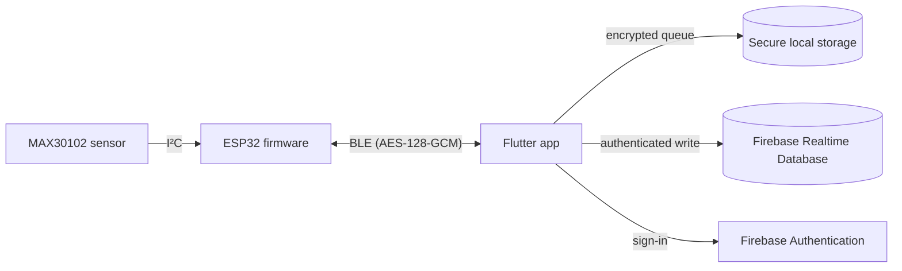

# CarePulse

**A Flutter app and ESP32 sensor for logging heart rate (BPM) and blood oxygen (SpO₂), with encrypted BLE pairing and cloud history.**


> [!WARNING]
> CarePulse is a prototype for personal logging. It is **not a medical device** and does not diagnose any condition. Sensor accuracy has not been clinically validated.

---

## Overview

CarePulse pairs a phone with a small ESP32 board fitted with a MAX30102 pulse-oximetry sensor. The user starts a scan from the app and places a finger on the sensor. The board measures BPM and SpO₂ and sends the result back over Bluetooth Low Energy (BLE).

The phone, not the board, uploads each result to the user's Firebase account. The ESP32 never needs Wi-Fi or cloud credentials. If the phone is offline, results are kept in encrypted local storage and uploaded once the connection returns.

## Features

- **One-tap scans over BLE.** The app finds the nearby CarePulse board, connects, and shows scan progress in real time.
- **Authenticated pairing.** Each board has its own 128-bit pairing key. Sessions use HMAC-SHA256 key derivation and AES-128-GCM encrypted frames with replay protection.
- **Offline-first sync.** Completed scans are saved in encrypted storage and retried on reconnect, on app resume and every minute. Request IDs prevent duplicate uploads.
- **Account history.** Sign in with email and password. History is cached for offline viewing, and readings not yet uploaded are marked as pending.
- **Measurement context.** Tag each scan as Resting, Before Exercise, After Exercise, Recovery or Other, and add an optional note.
- **Owner-scoped security rules.** Users can read and write only their own validated measurements.
- **Demo mode.** The **Preview scan flow** shows the full experience with sample data when no board is available.
- **Sensor calibration.** Serial commands set the finger-contact threshold for the sensor in its final housing.

## Architecture



1. The app connects to the board and completes the encrypted pairing handshake.
2. The app sends a scan command with a unique request ID.
3. The board streams progress events (waiting for finger, scanning, processing) and then the result.
4. The app shows the result and stores it in the pending queue.
5. The queue uploads the result to `users/<uid>/measurements/<requestId>` in Firebase. On success, the local copy is removed.

Design rationale and the BLE frame format are in [ARCHITECTURE_DECISION_BLE.md](ARCHITECTURE_DECISION_BLE.md).

## Tech stack

| Layer | Technology |
| --- | --- |
| Mobile and web app | Flutter, Dart 3.12, Material 3, Nunito font |
| BLE | `flutter_reactive_ble` |
| Cryptography | `pointycastle` (AES-GCM), `crypto` (HMAC-SHA256) |
| Local storage | `flutter_secure_storage` |
| Connectivity | `connectivity_plus` |
| Backend | Firebase Authentication (email/password), Firebase Realtime Database |
| Cloud Functions (prototype) | Node.js 22, `firebase-functions`, `firebase-admin` |
| Firmware | Arduino-ESP32 core 3.x, SparkFun MAX3010x library, ESP32 BLE |
| Hardware | ESP32 Dev Module, MAX30102 breakout, status LEDs, passive piezo buzzer |
| Testing | `flutter_test`, Node test runner, `@firebase/rules-unit-testing`, Firebase emulators |

## Project structure

```text
carepulse/
├── lib/
│   ├── core/            # Theme and formatters
│   ├── models/          # Measurement and Device models
│   ├── screens/         # Auth, home, live BLE scan, history, profile
│   └── services/        # BLE transport and protocol, secure session, sync, Firebase
├── test/                # Flutter unit and widget tests
├── firmware/            # ESP32 Arduino sketches (see firmware/README.md)
├── functions/           # Cloud Functions prototypes (not deployed)
├── tools/
│   ├── rules/           # Realtime Database rules tests (emulator)
│   ├── gateway/         # USB serial gateway prototype
│   └── security/        # BLE crypto test vectors
├── database.rules.json  # Deployed Realtime Database rules
└── firebase.json
```

## Getting started

### Prerequisites

- [Flutter SDK](https://docs.flutter.dev/get-started/install) with Dart 3.12 or later
- An Android phone with BLE. BLE scans do not work on web.
- Arduino IDE with the Espressif **esp32** board package (core 3.x)
- Node.js 22 and the Firebase CLI, only for the backend tests

### Run the app

From this directory:

```bash
flutter pub get
flutter run
```

Firebase is configured for Android and web in `lib/firebase_options.dart`. To use your own Firebase project, run `flutterfire configure` and deploy the rules:

```bash
firebase deploy --only database
```

### Flash the firmware

1. Wire the MAX30102 to the ESP32: SDA to **GPIO18**, SCL to **GPIO19**, VCC to **3V3**, and GND to GND.
2. Install the **SparkFun MAX3010x Pulse and Proximity Sensor Library**.
3. Open `firmware/carepulse_single_scan_debug/carepulse_single_scan_debug.ino`, select **ESP32 Dev Module**, and upload.

The full wiring table, calibration steps and Serial commands are in [firmware/README.md](firmware/README.md).

### Pair a phone

1. Connect the board to a trusted computer over USB. Open Serial Monitor at **9600 baud** with **Newline** enabled.
2. Send `PAIR`. The board prints its 32-character pairing key.
3. In the app, select the **CarePulse** device and enter the key.

> [!CAUTION]
> Treat the pairing key like a password. Do not put it in screenshots, logs, source code or uploaded readings. Anyone with the key, or with physical USB access to the board, can pair another phone.

## Testing

```bash
# Flutter app
flutter test
flutter analyze

# Realtime Database rules (requires the Firebase CLI and emulator)
cd tools/rules
npm install
npm test
npm run test:ble-write

# USB gateway prototype
cd tools/gateway
npm install
npm test
```

## Project status

| Area | Status |
| --- | --- |
| Firebase sign-in, registration and sign-out | Working |
| BLE discovery, connection and scan | Verified on a Samsung SM-A135F with a debug APK |
| Offline queue and upload to account history | Verified once end to end on the same phone |
| Authenticated BLE pairing (AES-GCM) | Implemented; needs an end-to-end hardware test |
| Sensor accuracy | Not validated against a reference device |
| iOS | Not configured for Firebase |
| Cloud Functions and USB gateway | Prototypes, not deployed |

## Documentation

- [ARCHITECTURE_DECISION_BLE.md](ARCHITECTURE_DECISION_BLE.md): BLE architecture and protocol
- [PROJECT_HANDOFF.md](PROJECT_HANDOFF.md): detailed status and code map
- [firmware/README.md](firmware/README.md): hardware, wiring, calibration and pairing
- [PHASE3_FIREBASE.md](PHASE3_FIREBASE.md): initial Firebase data model proposal
- [PHASE5_ACCESS.md](PHASE5_ACCESS.md): earlier scan flow and USB gateway prototype
